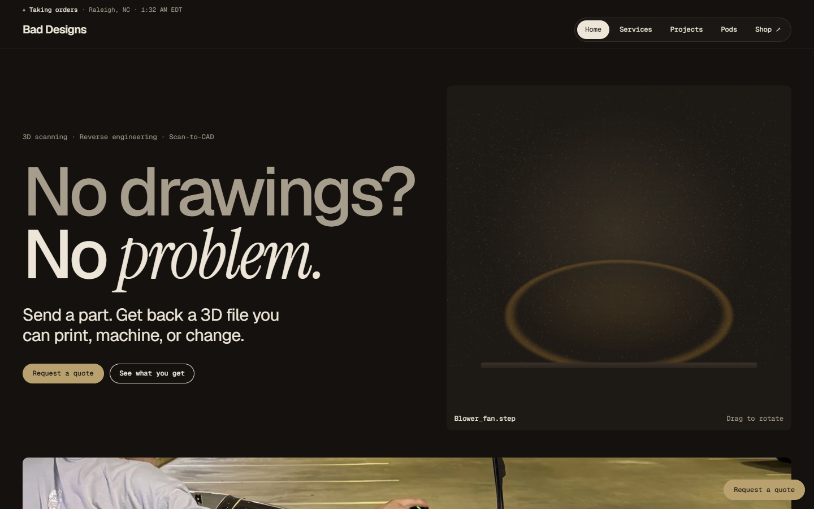
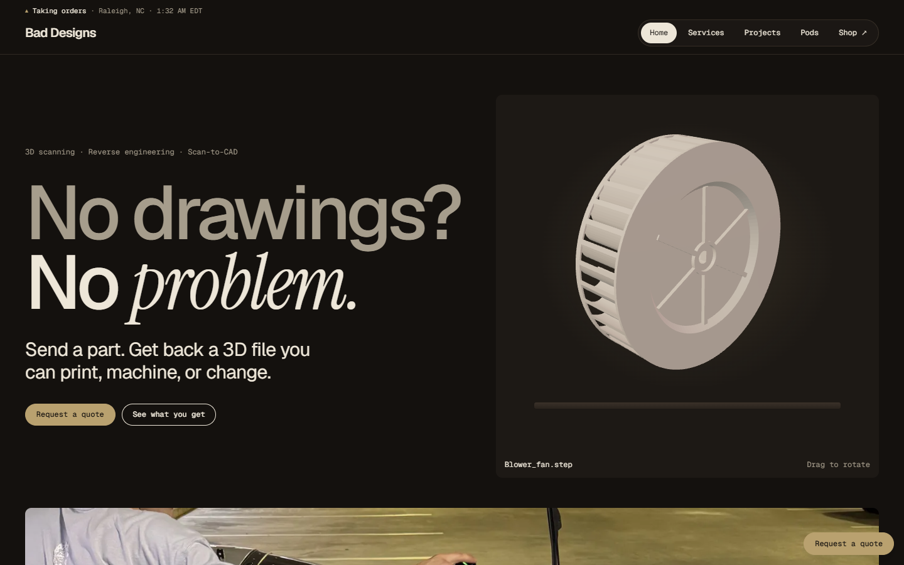
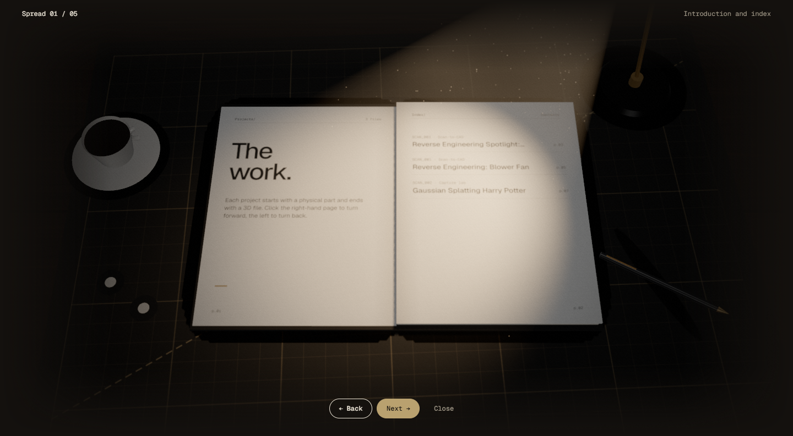
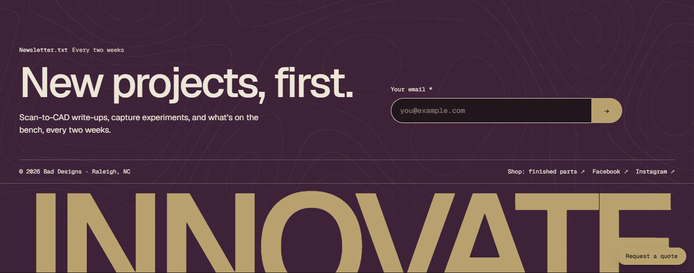

# Bad Designs: 3D web showcase

Selected front-end code from the two sites behind **Bad Designs**, a scan-to-CAD studio
that 3D scans physical parts and rebuilds them as editable CAD models and printed parts.

- Studio site: **[baddesigns.net](https://baddesigns.net)** (Astro on Cloudflare Pages)
- Shop: **[shop.baddesigns.net](https://shop.baddesigns.net)** (Next.js on Vercel)

These are excerpts from the production code, so imports that point at the rest of
each project (content collections, layout, constants) aren't included here.

## The pieces

### Scan-to-CAD hero: `astro/src/scripts/hero-scan.ts`
A three.js scene that acts out the studio's service in about five seconds: a laser
ring sweeps up a blower-fan part and leaves a point cloud behind it, then the solid
CAD model is revealed. Drag or arrow keys rotate it.

- Point cloud sampled from the mesh surface, revealed by a shader uniform tied to the sweep height
- three.js is loaded only after the page has loaded, so it never blocks first paint
- Falls back to `<model-viewer>` without WebGL; holds a still frame for reduced motion
- Stops rendering once the sequence ends, so an idle page uses no GPU

### Lamp-lit projects book: `ProjectsBook.astro`, `portfolio-book.ts`, `book-scene.ts`, `book-pages.ts`
The portfolio is a 3D book on a desk under a brass lamp. Every published project
becomes a spread; pages turn on click, arrow keys or buttons.

- Page artwork drawn to canvas textures from the project data (`book-pages.ts`)
- Physically based materials, a spotlight with a visible beam, floating dust, film grain
  and post-processing (`book-scene.ts`, commented as a learning reference)
- Ambient motion runs for five seconds after the last interaction, then the render loop stops
- Fully keyboard operable, with focus kept inside the book when the focused control hides itself

### Topographic footer: `astro/src/scripts/topo-field.ts`
Plain WebGL (no library): a fragment shader draws banded-noise contour lines over a
fine grid, coloured from CSS custom properties. It drifts for a few seconds when
scrolled into view, then holds still. Adapted from ThreeUI's MIT "Topo Field".

### Token colour system: `astro/src/styles/global.css`
Every colour on the site comes from one `:root` block of design tokens: warm dark
browns, a tan accent, plum and burgundy used sparingly. Every text pair was checked
against WCAG 2.2 AA (lowest ratio 5.26:1), and the light palette sits beside it so the
whole site can switch themes by swapping one block.

### Form spam and rate-limit guard: `nextjs/app/api/_lib/form-guard.ts`
Shared protection for the shop's form endpoints: a honeypot field, a maximum body
size, per-field length limits, a per-IP rate limit, and single-line sanitising for
anything that ends up in an email header. Nothing the customer typed is logged.

## Stack

Astro · Next.js · TypeScript · three.js · WebGL/GLSL · CSS custom properties ·
Cloudflare Pages · Vercel

## License

MIT for this code. Third-party pieces keep their own licenses; see `LICENSE`.
